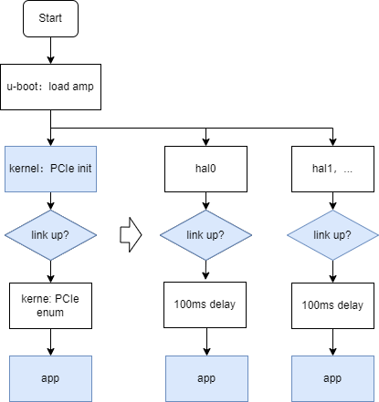
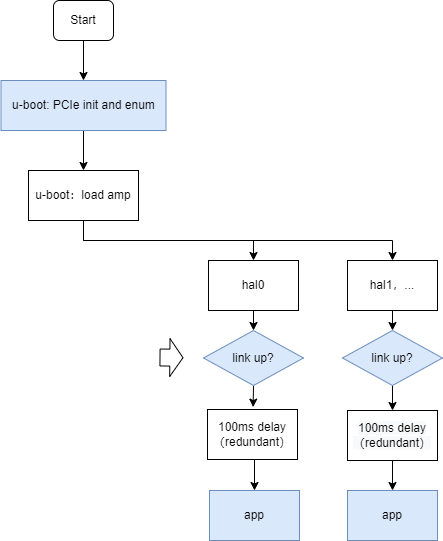

# Rockchip HAL PCIe 用户指南 {#Rockchip_User_Guide_HAL_PCIe}

发布版本：V1.4.0

日期：2025-04-09

文件密级：□绝密   □秘密   □内部资料   ■公开

**免责声明**

本文档按“现状”提供，瑞芯微电子股份有限公司（“本公司”，下同）不对本文档的任何陈述、信息和内容的准确性、可靠性、完整性、适销性、特定目的性和非侵权性提供任何明示或暗示的声明或保证。本文档仅作为使用指导的参考。

由于产品版本升级或其他原因，本文档将可能在未经任何通知的情况下，不定期进行更新或修改。

**商标声明**

“Rockchip”、“瑞芯微”、“瑞芯”均为本公司的注册商标，归本公司所有。

本文档可能提及的其他所有注册商标或商标，由其各自拥有者所有。

**版权所有 © 2025 瑞芯微电子股份有限公司**

超越合理使用范畴，非经本公司书面许可，任何单位和个人不得擅自摘抄、复制本文档内容的部分或全部，并不得以任何形式传播。

瑞芯微电子股份有限公司

Rockchip Electronics Co., Ltd.

地址：     福建省福州市铜盘路软件园A区18号

网址：     [www.rock-chips.com](http://www.rock-chips.com)

客户服务电话： +86-4007-700-590

客户服务传真： +86-591-83951833

客户服务邮箱： [fae@rock-chips.com](mailto:fae@rock-chips.com)

---

**前言**

**概述**

本文介绍 HAL PCIe 的使用说明，HAL 源码可用于 bare metal 或 RTOS 系统环境，仅支持简单功能操作。

| **芯片名称** | **内核版本** |
| ------------ | ------------ |
| 所有平台     | HAL/RTOS     |

**读者对象**

本文档（本指南）主要适用于以下工程师：

技术支持工程师

软件开发工程师

**修订记录**

| **版本号** | **作者** | **修改日期** | **修改说明**             |
| ---------- | -------- | ------------ | ------------------------ |
| V1.0.0     | 林鼎强   | 2023-04-04   | 初始版本                 |
| V1.1.0     | 林鼎强   | 2024-08-08   | 添加开发参考文档         |
| V1.2.0     | 林鼎强   | 2025-02-13   | 添加软件配置说明         |
| V1.3.0     | 林鼎强   | 2025-03-18   | 优化应用说明             |
| V1.4.0     | 林鼎强   | 2025-04-09   | 修改 EP legacy INTx 接口 |

---

**目录**

[TOC]

---

## 简介

由于 bare metal 或 RTOS 工程下无完整的 PCIe 框架代码，需依赖 u-boot 或 Linux 下的 PCIe 初始化及枚举流程，bare metal 或 RTOS 下仅支持以下简单功能：

- 控制器寄存器访问
- CPU 访问外设，主要包括 Bar、CFG 空间
- uDMA 传输
- INTx legacy 中断

所以除了该文档所介绍的 HAL 接口，还需要准备以下开发工作：

- RC 侧，开发 u-boot 或 Linux 下的 PCIe 初始化及枚举流程：
    - 参考 Rockchip_Developer_Guide_UBoot_Nextdev_CN.pdf
    - 参考 Rockchip_Developer_Guide_PCIe_CN.pdf
- EP 侧，仅供 RK EP 参考，可选 spl 阶段初始化 PCIe、或 Linux 阶段初始化 PCIe：
    - 参考 Rockchip_Developer_Guide_PCIE_EP_Stardard_Card_CN.pdf，建议先参考 RK EP demo 版图纸做硬件设计规范，例如：
        - PCIe 互联存在主从关系，枚举由 RC 引导 EP 复位时序，RK EP 方案建议通过 PERST# 信号控制 EP 设备 NPOR
        - 同源时钟方案

## 规范说明

### RK RC 软件配置及启动方案

**kernel 初始化 PCIe 方案（推荐）**



说明：

- 流程中的 “100 ms delay” 为等待 PCIe 外设驱动加载完成的冗余时间，可用业务代码上的握手协议替代
- kernel PCIe 开发参考《Rockchip_Developer_Guide_PCIe_CN.pdf》文档，可通过 lspci 命令获取 bdf、bar 映射 等重要信息

**u-boot 初始化 PCIe 方案**



- 流程中的 “100 ms delay” 为等待 PCIe 外设驱动加载完成的冗余时间，实际上 u-boot 已完成该流程，冗余延时可手动删除
- u-boot PCIe 开发参考《Rockchip_Developer_Guide_UBoot_Nextdev_CN.pdf》文档 PCIe 章节，主要涉及：
    - “加载 kernel dtb 之前使用 PCIe” 配置说明
    - pci cmd 获取 PCIe 外设信息，包括 bdf、bar 映射 等重要信息

### RK EP 软件配置

如果使用 RK EP 作为外设，且有裸核开发需求，建议阅读《Rockchip_Developer_Guide_PCIE_EP_Stardard_Card_CN.pdf》手册，使用“Flash Boot”启动方案，集成 PCIe Bin 驱动，在 loader 阶段完成 PCIe 初始化、枚举，在裸核中开发 RK EP 设备驱动。

### 资源分配

PCIe 除了 CPU 访问 Bar 资源，其他资源通常都涉及竞争，所以多系统公用同一个 PCIe 控制器，应预先分配好资源：

| 资源              | 说明                                                         |
| ----------------- | ------------------------------------------------------------ |
| CPU 访问 Bar 资源 | 不涉及竞争，多核访问由总线仲裁                               |
| CPU 访问 CFG 空间 | 读不涉及竞争，写涉及一致性问题                               |
| uDMA              | 支持 2 通道，通道之间独立，但多核访问同一个 DMA 通道涉及竞争 |
| INTx              | 涉及竞争                                                     |
| 控制器寄存器      | 应尽量避免同时访问，根据实际情况细化分析                     |
| MSI               | 仅 kernel 中支持                                             |

## RC 应用说明

系列支持参考 test_pcie.c 源码 TEST_GROUP_RUNNER(HAL_PCIE) 测试。

### 设置外设

参考"RK RC 软件配置及启动方案"章节说明，确认PCIe设备信息化后 ，修改 test_pcie.c 以下信息，以设备 01.00.00、BAR0 映射地址 0xF0200000 为例：

```c
#define TEST_DEVICE              PCI_BDF(0x01, 0x00, 0x00) /**< Valid for rc, reset PCIe bdf according to the actual device */
#define TEST_DEVICE_BAR_CPU_ADDR 0xF0200000 /**< Valid for rc, reset PCIe bus according to the actual device */
#define TEST_DEVICE_TEST_SIZE    0x100
```

### 使能外设

```c
HAL_PCI_EnableDevice(&s_pcieHandle.dev->cfgBase);
```

### CPU 访问外设 CFG 空间

```c
HAL_PCIE_OutboundConfigCFG0(&s_pcieHandle, TEST_DEVICE, 0x100000);
HAL_PCI_ReadConfigWord(cfg, PCI_VENDOR_ID, &vid);
HAL_PCI_ReadConfigWord(cfg, PCI_DEVICE_ID, &did);
```

说明：

- 多次读写 CFG 空间，仅需调用一次 HAL_PCIE_OutboundConfigCFG0 接口

### CPU 访问外设 Bar 空间

参考 PCIeCPUSimpleTest 测试：

```c
void *bar = (void *)TEST_DEVICE_BAR_CPU_ADDR;

memset_io(bar, 0xa5, len);
memcpy_fromio(buf, bar, len);
memcpy_toio(bar, buf, len);
```

### DMA 传输

参考 hal_pcie.c 文档 doxygen 注释 PCIE_How_To_Use 说明。参考 TRM 确认 RK SOC 目标 PCIe 控制器是否支持 uDMA 实现。

- EP 集成 DMA 引擎：
    - FPGA 等通用外设通常自身会集成 DMA，请使用外设 DMA 引擎发起 DMA 传输
    - RK EP 默认将内置 DMA 控制器寄存器到 BAR4 寄存器（wired register），RC 侧支持配置 BAR4 发动 EP 侧 DMA 引擎，发起 DMA 传输，详细请参考 test_pcie.c 源码 PCIeDMASimpleTest 实例：
        - 确认 MMU 内存映射设定添加`TEST_PCIE_DMA_LOCAL_ADDR`测试地址
- EP 未集成 DMA 引擎，RK RC 如集成 DMA 引擎：
    - 支持启用自身 DMA，详细请参考 test_pcie.c 源码 RKRC_PCIeDMASimpleTest 源码
    - 确认修改`TEST_PCIE_DMA_BUS_ADDR`为目标 BAR 地址，也就是 EP 所分配的 BAR 映射地址
    - 确认 MMU 内存映射设定添加`TEST_PCIE_DMA_LOCAL_ADDR`测试地址

### 接收 INTx 中断

```c
HAL_IRQ_HANDLER_SetIRQHandler(g_pcieDev.legacyIrqNum, PCIE_INTxIsr, NULL);
HAL_GIC_Enable(g_pcieDev.legacyIrqNum);
HAL_PCIE_EnableLegacyINTx(&s_pcieHandle, 0);
HAL_PCI_EnableLegacyINTx(&s_pcieHandle.dev->cfgBase);
```

说明：

- AMP 环境下 Linux 系统端仅使能 MSI/MSI-X中断，所以 legacy 中断可供 HAL 环境下，分配方案参考：
    - Core A 使用 Linux，独占 MSI/MSI-X 中断
    - Core B 使用 HAL/RTOS，独占 legacy INTx 中断
    - Other Cores，无独占中断资源，仅能由 CoreA/B 通知
- 由于 HAL 框架下没有对外设做 INTX 号分配，为默认值，请用户根据实际应用分配 INTx 中断号给外设

### 触发 ELBI 中断

```c
PCIE_RaiseELBI(&s_pcieHandle, 0);
```

## EP 应用说明

系列支持参考 test_pcie.c 源码 TEST_GROUP_RUNNER(HAL_PCIE_EP) 测试。

### CPU 访问主机 Dram 空间

```c
HAL_PCIE_OutboundConfig(&s_pcieHandle, 0, PCIE_ATU_TYPE_MEM, &s_pcieHandle.dev->cfgBase, 0x3c000000, 0x100000);
memset_io(bar, 0xa5, len);
memcpy_fromio(buf, bar, len);
memcpy_toio(bar, buf, len);
```

### DMA 传输

参考 PCIeDMASimpleTest 实例。

### 接收 ELBI 中断

ELBI 中断为 RK EP 特殊功能，支持 RC 通过配置 config space ELBI 寄存器来触发 EP 侧的控制器中断：

```c
HAL_IRQ_HANDLER_SetIRQHandler(g_pcieDev.sysIrqNum, PCIE_SYSIsr, NULL);
HAL_GIC_Enable(g_pcieDev.sysIrqNum);
/* Enable client elbi interrupt */
HAL_PCIE_EnableELBIIndex0(&s_pcieHandle);
```

### 触发 MSI 中断

```c
HAL_PCIE_RaiseMSI(&s_pcieHandle, 0);
```

### 触发 Legacy 中断

```c
HAL_PCIE_RaiseLegacyINTx(&s_pcieHandle, 0);
```

## 常见问题

### RC BAR 读写不生效

- 确认`TEST_DEVICE_BAR_CPU_ADDR`是否已正确修改为外设所分配的 BAR 映射地址

### RC DMA 传输数据不符合预期

- 不是所有 PCIe 控制器都支持 DMA 传输，先确认该 PCIe 控制器是否支持 DMA 传输
- 请确认两侧内存是否为 normal memory 属性，填充/获取内存是否执行内存一致性操作，例如 cache invalidate/flush
- 建议先使用 RK 默认测试代码验证传输有效后，再做代码移植、定制

### RC 触发 RK EP ELBI 中断不生效

- 确认 HAL_PCIE_OutboundConfigCFG0 没有被多次调用，仅允许调用一次
