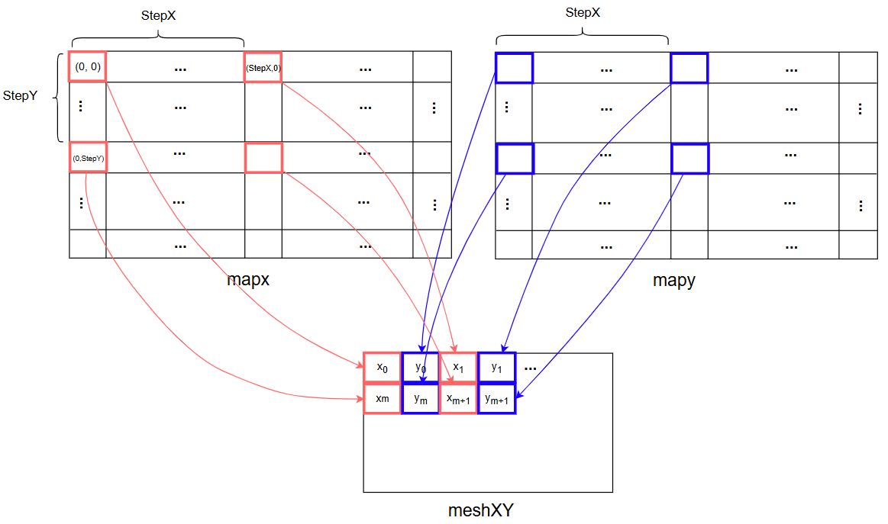
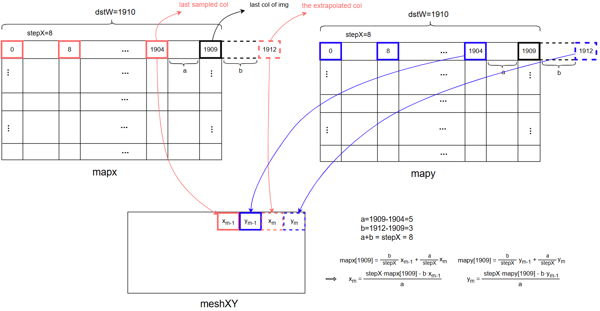
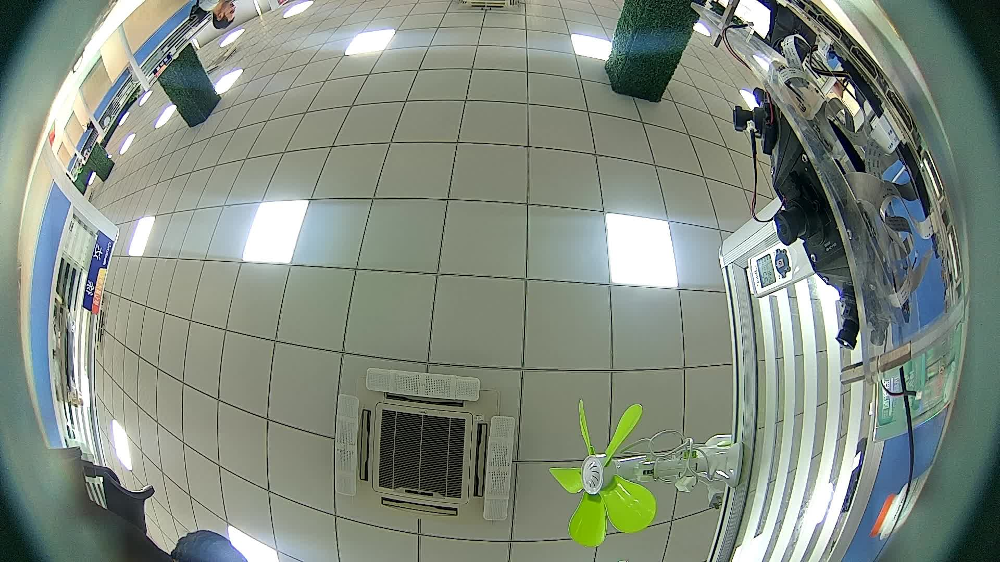
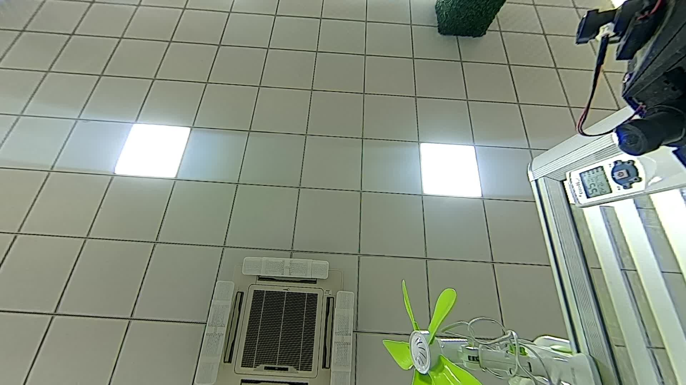

# Rockchip IDC 调试指南

文件标识：RK-KF-SF-047

发布版本：V1.0.0

日期：2025-04-02

文件密级：□绝密   □秘密   □内部资料   ■公开

**免责声明**

本文档按“现状”提供，瑞芯微电子股份有限公司（“本公司”，下同）不对本文档的任何陈述、信息和内容的准确性、可靠性、完整性、适销性、特定目的性和非侵权性提供任何明示或暗示的声明或保证。本文档仅作为使用指导的参考。

由于产品版本升级或其他原因，本文档将可能在未经任何通知的情况下，不定期进行更新或修改。

**商标声明**

“Rockchip”、“瑞芯微”、“瑞芯”均为本公司的注册商标，归本公司所有。

本文档可能提及的其他所有注册商标或商标，由其各自拥有者所有。

**版权所有 © 2025 瑞芯微电子股份有限公司**

超越合理使用范畴，非经本公司书面许可，任何单位和个人不得擅自摘抄、复制本文档内容的部分或全部，并不得以任何形式传播。

瑞芯微电子股份有限公司

Rockchip Electronics Co., Ltd.

地址：     福建省福州市铜盘路软件园A区18号

网址：     [www.rock-chips.com](http://www.rock-chips.com)

客户服务电话： +86-4007-700-590

客户服务传真： +86-591-83951833

客户服务邮箱： [fae@rock-chips.com](mailto:fae@rock-chips.com)

---

**产品版本**

与本文档相对应的产品版本如下：

| **产品名称** | **产品版本** |
| -------- | -------- |
| RK3588   |          |
| RK3576   |          |
| RK3562   |          |

**读者对象**

本文档（本指南）主要适用于以下工程师：

技术支持工程师

**修订记录**

| **版本号**    | **作者**   | **修改日期**       | **修改说明**         |
| --------| ------- | -------- | ---------------- |
| Beta-v0 | 陈杰克 | 2024-06-20 | 初稿             |
| Beta-v1 | 陈杰克 | 2025-01-21 |                  |
| v1.0.0  | 陈杰克 | 2025-04-02 | 修改 Mesh 表说明 |

---

**目录**

[TOC]

---

## 概述

**IDC (Image Distortion Correction, 图像畸变校正)** 是基于 GPU 的图像几何校正加速算法，实现图像重映射功能，可用于视频防抖、畸变校正、全景拼接等视觉应用。本文介绍图像畸变校正的基本原理、功能和注意事项。

IDC 应用接口的说明、参数定义和调用示例，见 "Rockchip_IDC_Developer_Tutorial_CN.md".

## 基本概念

<u>**查找表/Mesh 表**</u>

查找表（Look-Up Table, LUT）包含了一系列预计算的映射坐标值，可以通过查表 (Backward remapping) 的方式，将原始图像上的坐标内容重映射到目标图像中。
为了节约带宽，查找表是稀疏的，X 方向和 Y 方向的采样步长可以分别设置，典型值为 ${4, 8,16,32}$.
根据数据类型，Mesh 表可分为浮点表和定点化表。

- 浮点表：供 GPU 硬件使用。每个 X 坐标和 Y 坐标的值都用 32 bit 的浮点类型存储。
  如果 X 和 Y 数据分别存储在单独的文件中，则为独立浮点表，形如 meshx.bin, meshy.bin；
  如果 X 和 Y 数据交织存储在同个文件中，则为交织浮点表，形如 meshxy.bin。
- 定点化表：也称 FEC 表，供 FEC 硬件使用，由浮点表转化而来。每个坐标的整数部分用 16 bit 存储，小数部分用 8 bit 的存储。形如meshxi.bin, meshxf.bin, meshyi.bin, meshyf.bin。

将 OpenCV 中 `cv::remap` 所用的稠密浮点表 mapx,mapy 转换为 IDC 所用的稀疏交织浮点表 meshXY 可参照以下示意图（图1-2-1），其中 mapx/mapy 的尺寸和图像大小相同，按照水平方向间隔 stepX、竖直方向间隔 stepY 的方式采样，即可得到稀疏交织浮点表。

<div style="display: flex; justify-content: space-around; align-items: flex-start;">
    <div style="flex: 1; text-align: center;">
        
        <p style="margin-top: 5px;">图1-2-1: mesh表转换示意图</p>
    </div>

为了保证图像在行末/列末位置的映射效果，需要按照线性规则，将 mesh 表内容外推一个点。

行方向上的外推如图 1-2-2 所示，图中行索引为 1905~1909 区域的图像结果，依赖于最后一个真实采样点 x~m-1~(索引1904)和一个虚拟外推采样点 x~m~(索引1912)，x~m~ 的内容根据线性公式计算得出。

<div style="display: flex; justify-content: space-around; align-items: flex-start;">
    <div style="flex: 1; text-align: center;">
        
        <p style="margin-top: 5px;">图1-2-2: mesh表行方向外推示意图</p>
    </div>

将稠密表 mapx/mapy 转换为稀疏交织浮点表，可以参照以下代码。

```c++
void convertDenseMapToIDCMeshXY(
	int dstW, int dstH,
	int meshW, int meshH,
	int stepX, int stepY,
    float *pf32mapx, float *pf32mapy,
    float *pMeshXY)
{
    for (int row = 0, mesh_row = 0; mesh_row < meshH; row += stepY, mesh_row++) {
		for (int col = 0, mesh_col = 0; mesh_col < meshW; col += stepX, mesh_col++) {
			size_t mesh_idx = (mesh_row * meshW + mesh_col) * 2;
			if (col >= dstW) {    /* Right border */
				int last_sampled_col = col;
				while (last_sampled_col >= dstW) {
					last_sampled_col -= stepX;
				}
				int a = (dstW - 1) - last_sampled_col;
				int b = col - (dstW - 1);
				float x_last_sampled = pMeshXY[2 * (last_sampled_col / stepX + meshW * mesh_row)];
				float y_last_sampled = pMeshXY[2 * (last_sampled_col / stepX + meshW * mesh_row) + 1];
                size_t map_idx = std::min(row, dstH - 1) * dstW + (dstW - 1);
				float x_last_img = pf32mapx[map_idx];
				float y_last_img = pf32mapy[map_idx];
				float x_extrapolated = (stepX * x_last_img - b * x_last_sampled) / a;
				float y_extrapolated = (stepX * y_last_img - b * y_last_sampled) / a;
				pMeshXY[mesh_idx] = x_extrapolated;
				pMeshXY[mesh_idx + 1] = y_extrapolated;
				continue;
			}
			if (row >= dstH) {  /* Bottom border */
				int last_sampled_row = row;
				while (last_sampled_row >= dstH) {
					last_sampled_row -= stepY;
				}
				int a = (dstH - 1) - last_sampled_row;
				int b = row - (dstH - 1);
                float x_last_sampled = pMeshXY[2 * (mesh_col + meshW * last_sampled_row / stepY)];
				float y_last_sampled = pMeshXY[2 * (mesh_col + meshW * last_sampled_row / stepY) + 1];
				float x_last_img = pf32mapx[(dstH - 1) * dstW + col];
				float y_last_img = pf32mapy[(dstH - 1) * dstW + col];
				float x_extrapolated = (stepY * x_last_img - b * x_last_sampled) / a;
				float y_extrapolated = (stepY * y_last_img - b * y_last_sampled) / a;
				pMeshXY[mesh_idx] = x_extrapolated;
				pMeshXY[mesh_idx + 1] = y_extrapolated;
				continue;
			}
			size_t map_idx = row * dstW + col;
			pMeshXY[mesh_idx] = pf32mapx[map_idx];
			pMeshXY[mesh_idx + 1] = pf32mapy[map_idx];
		}
	}
}
```

**注意**：已有 Mesh 生成规则的情况下（例如：根据相机标定文件生成 Mesh 表），也可以不通过线性外推，直接用公式计算外推点的内容。

---

## 功能模块

IDC 由多个功能模块构成，目前包括：图像查表重映射 LUT.

### LUT

LUT 是根据给定的查找表进行图像重映射 (remap) 的应用。

#### 基本概念

<u>**重映射算子**</u>

算法内部使用 GPU 并行技术对查表任务进行加速计算。根据线程内数据规模的大小，设计了 4 种不同类型的重映射算子。执行重映射任务时，可协同处理的相关线程组成一个工作组，组内的线程规模称为 localSize。
算子类型和 localSize 共同影响重映射任务的执行效率，故两者合称为算子属性。使当前重映射任务具有最佳效率的算子称为最优算子。

#### 功能描述

根据查找表的内容，LUT 应用可实现图像缩放、畸变校正、仿射变换等功能。所用的查找表可由 IDC 内部其他应用生成，也可由用户自行生成。

LUT 应用包括 3 种计算模式：

- 默认模式：无需设置算子属性。将采用默认设置。
- 自动模式：无需设置算子属性。初次运行时自动嗅探所有算子，并找出其中的最优算子。所有算子的性能情况默认写出到 .csv 文件中用于查看。由于嗅探算子的耗时较长，该模式适用于查找表固定的场景。
- 手动模式：需要设置算子属性，其中算子类型为必填项，localSize 为选填项，如省略则由算法内部自动计算。

#### 效果预览

使用畸变校正表作为查找表，图像重映射的效果如图2-1-4-1所示。

<div style="display: flex; justify-content: space-around; align-items: flex-start;">
    <div style="flex: 1; text-align: center;">
        
        <p style="margin-top: 5px;">畸变图像</p>
    </div>
    <div style="flex: 1; text-align: center;">
        
        <p style="margin-top: 5px;">校正图像</p>
    </div>
</div>
<center>
    图2-1-4-1: 图像重映射效果预览
</center>